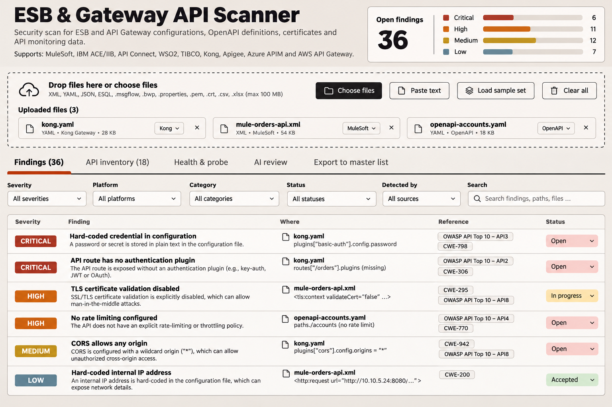

# ESB & Gateway API Security Scanner

A browser-based security assessment tool designed to analyze Enterprise Service Bus (ESB) configurations, API Gateway policies, OpenAPI specifications, certificates, and API monitoring data.

The scanner identifies potential security misconfigurations, exposed credentials, authentication weaknesses, transport security issues, missing rate limits, API governance gaps, and operational health concerns.

## Overview

The ESB & Gateway API Security Scanner helps security professionals, penetration testers, application security teams, and integration architects perform configuration-level security assessments of enterprise API infrastructure.

It combines automated rule-based checks, API inventory extraction, certificate analysis, health monitoring, and optional AI-assisted configuration review.

## Supported Platforms

- MuleSoft
- IBM App Connect Enterprise (ACE/IIB)
- IBM API Connect
- WSO2 API Manager
- TIBCO BusinessWorks
- Kong Gateway
- Apigee
- Azure API Management
- AWS API Gateway
- OpenAPI / Swagger

## Key Features

### 1. Security Configuration Scanning

Identifies potential security issues, including:

- Hardcoded credentials and passwords
- AWS access key exposure
- Embedded private keys
- Hardcoded JWT and bearer tokens
- Plain-text HTTP endpoints
- Disabled TLS certificate validation
- Weak TLS protocols and cipher configurations
- Wildcard CORS configurations
- Internal error information disclosure
- Debug and trace logging
- Sensitive information in application logs
- Hardcoded internal IP addresses
- TRACE and TRACK methods

### 2. Authentication and Authorization Checks

Identifies potential authentication and access control weaknesses:

- Missing API authentication policies
- Missing OAuth/JWT enforcement
- Disabled API gateway enforcement
- Inactive IBM ACE administration security
- Missing authentication plugins
- Missing authentication handlers

### 3. Rate Limiting and API Protection

Checks for missing or insufficient API protection policies:

- Missing Kong rate-limiting plugins
- Missing Apigee SpikeArrest and Quota policies
- Missing Azure APIM rate limits
- Missing WSO2 throttling policies
- Missing AWS API throttling or usage plans
- API protection and schema validation gaps

### 4. API Inventory and Governance

Extracts API information from supported configuration files:

- API and service names
- API paths and routes
- HTTP methods
- Backend URLs
- Authentication configurations
- Rate-limiting configurations
- API version information

Also identifies potential duplicate API routes, older exposed API versions, and backend IP references.

### 5. Certificate Security Analysis

Analyzes uploaded certificates for:

- Expired certificates
- Certificates approaching expiration
- Weak SHA-1 or MD5 signature algorithms

### 6. API Health and Monitoring

Supports monitoring CSV imports and generates a Python-based read-only probe script.

The health module analyzes:

- API availability
- HTTP response codes
- p50 and p95 latency
- HTTP 5xx errors
- TLS certificate expiry
- HSTS header presence
- Server version disclosure
- Unauthenticated GET responses
- CORS origin reflection

### 7. AI-Assisted Security Review

Provides optional AI-assisted configuration analysis for additional potential issues, including:

- Missing timeouts
- Missing circuit breakers
- Authorization logic weaknesses
- Unbounded payloads
- Undocumented endpoints
- Configuration and resilience concerns

Detected secrets are masked before AI review.

AI functionality requires the compatible AI integration runtime; it is not a standalone standard-browser feature.

### 8. Security Reporting and Export

Supports security assessment reporting through:

- Excel (.xlsx) export
- CSV export
- Custom master-list column mapping
- Finding identifiers
- Severity classification
- CVSS approximate reference values
- OWASP and CWE references
- Remediation recommendations
- Finding status tracking
- Target remediation dates
- Status dashboard
- API inventory and endpoint health worksheets

## Supported File Formats

| File Type | Extension |
|---|---|
| XML | .xml |
| YAML | .yaml, .yml |
| JSON | .json |
| ESQL | .esql |
| IBM ACE Flow | .msgflow, .subflow |
| TIBCO | .bwp, .bwm, .bwt |
| Properties | .properties |
| Certificates | .pem, .crt, .cer, .der |
| Monitoring | .csv, .tsv |
| Master list | .xlsx, .xlsm, .xls |

## Installation

No local package installation is required for the basic browser-based scanner.

### Option 1: Download from GitHub

1. Open the repository.
2. Click the Code button.
3. Select Download ZIP.
4. Extract the downloaded archive.
5. Open index.html in a modern web browser.

### Option 2: Clone the Repository

```bash
git clone https://github.com/Swanoop10082001/esb-gateway-api-security-scanner.git

cd esb-gateway-api-security-scanner
```

Open `index.html` in your browser.

The application uses external CDN libraries for YAML and Excel processing, so internet connectivity is required for those dependencies.

## How to Use

### Step 1: Open the Scanner

Open index.html in a modern web browser.

### Step 2: Upload Configuration Files

Upload supported ESB, API Gateway, OpenAPI, certificate, or monitoring files.

You can also paste configuration content directly into the scanner.

### Step 3: Review Findings

Navigate to the Findings tab to review detected security issues.

Filter findings by:

- Severity
- Platform
- Category
- Status
- Detection source

### Step 4: Review API Inventory

Navigate to API Inventory to inspect discovered API operations, paths, methods, backend services, authentication, and rate limiting.

### Step 5: Perform Health Checks

Generate the Python probe script and run it from an authorized network environment.

Import the resulting CSV into the scanner to review endpoint health.

### Step 6: Perform Additional AI Review

Where a compatible AI integration runtime is available, request an additional review of supported configuration files.

### Step 7: Export the Assessment

Navigate to Export to Master List.

Configure the environment, owner, SLA values, and column mappings.

Export findings into Excel or CSV format.

## Technology Stack

- HTML5
- CSS3
- JavaScript
- Python 3 (generated read-only probe)
- js-yaml 4.1.0
- SheetJS / XLSX 0.18.5
- Optional AI integration

## 📸 Dashboard Preview



## Security and Privacy

- Configuration files are processed locally in the browser for rule-based scanning.
- Files are not uploaded to a project backend by the scanner.
- Optional AI review sends redacted configuration text to the configured AI integration.
- The generated Python probe sends GET requests and CORS-check requests without credentials or attack payloads.
- Review sensitive configurations before uploading them to any external service.

## Important Limitations

- Rule-based results are heuristic indicators and require manual validation.
- Absence of a policy in an uploaded file does not prove that the policy is absent at the gateway or infrastructure level.
- Full platform configuration bundles provide better results than isolated files.
- The generated probe only performs the checks implemented in its script; it is not a comprehensive penetration test.
- AI functionality depends on a compatible integration runtime.
- Excel downloads also depend on the compatible download integration.
- API inventory and security findings depend on the configuration information provided.

## Disclaimer

This project is intended for authorized security assessments, defensive security testing, configuration reviews, and educational purposes.

Always obtain appropriate authorization before scanning or testing infrastructure.

The scanner does not replace a comprehensive penetration test, manual security assessment, or formal security audit. All findings should be validated before being reported as confirmed vulnerabilities.

## Contributions

Contributions, feature suggestions, bug reports, and improvements are welcome.

Please submit issues or pull requests through GitHub.

## License

This project is licensed under the MIT License.

You are free to use, copy, modify, distribute, and adapt this software in accordance with the MIT License terms.

See the LICENSE file for details.
