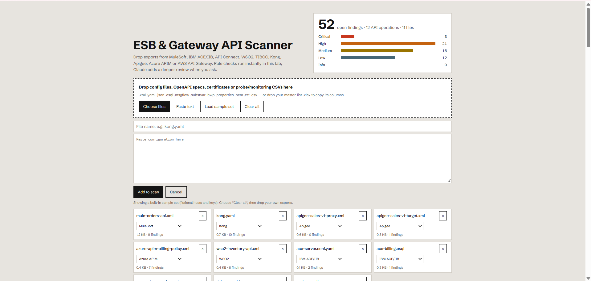

# ESB & Gateway API Security Scanner

A browser-based security assessment tool for reviewing Enterprise Service Bus (ESB) configurations, API Gateway policies, OpenAPI specifications, certificates, and API monitoring data.

The scanner uses rule-based analysis, API inventory extraction, certificate checks, endpoint health analysis, and optional AI-assisted configuration review to identify potential security weaknesses and configuration concerns.

## Overview

The **ESB & Gateway API Security Scanner** is designed to help security professionals, penetration testers, application security teams, and integration architects assess the security posture of enterprise API and integration environments.

It analyzes uploaded configuration files and monitoring data to identify potential issues such as exposed credentials, authentication configuration gaps, insecure transport settings, missing rate-limiting policies, API governance concerns, and operational health indicators.

The scanner provides findings with supporting evidence, severity classifications, references, and remediation recommendations to support security assessments.

## Supported Platforms

The scanner includes platform-specific configuration analysis for:

- MuleSoft
- IBM App Connect Enterprise (ACE/IIB)
- IBM API Connect
- WSO2 API Manager
- TIBCO BusinessWorks
- Kong Gateway
- Apigee
- Azure API Management
- AWS API Gateway
- OpenAPI / Swagger

## Key Features

### 1. Security Configuration Scanning

Identifies potential security misconfigurations and sensitive information exposure, including:

- Hardcoded credentials and passwords
- AWS access key exposure indicators
- Embedded private key indicators
- Hardcoded JWT and bearer tokens
- Plain-text HTTP endpoints
- Disabled TLS certificate validation
- Weak TLS protocols and cipher configurations
- Wildcard CORS configurations
- Internal error information disclosure
- Debug and trace logging
- Sensitive information written to application logs
- Hardcoded internal IP addresses
- TRACE and TRACK method references

### 2. Authentication and Authorization Checks

Identifies potential authentication and access control configuration gaps, including:

- Missing API authentication policies
- Missing OAuth/JWT enforcement indicators
- Disabled API gateway enforcement indicators
- Inactive IBM ACE administration security
- Missing authentication plugins
- Missing authentication handlers

### 3. Rate Limiting and API Protection

Checks for potential gaps in API protection policies, including:

- Missing Kong rate-limiting plugins
- Missing Apigee SpikeArrest and Quota policies
- Missing Azure APIM rate-limit policies
- Missing WSO2 throttling policies
- Missing AWS API throttling or usage-plan configuration indicators
- API protection and schema-validation gaps

### 4. API Inventory and Governance

Extracts API information from supported configuration files, including:

- API and service names
- API paths and routes
- HTTP methods
- Backend URLs
- Authentication configurations
- Rate-limiting configurations
- API version information

The inventory analysis also identifies potential duplicate API routes, older exposed API versions, and backend IP references.

### 5. Certificate Security Analysis

Analyzes uploaded certificates to identify:

- Expired certificates
- Certificates approaching expiration
- Weak SHA-1 or MD5 signature algorithms

### 6. API Health and Monitoring

Supports monitoring data imports and generates a Python-based read-only endpoint probe script.

The health analysis can review:

- API availability
- HTTP response codes
- p50 and p95 response latency
- HTTP 5xx errors
- TLS certificate expiry
- HSTS header presence
- Server version disclosure
- Unauthenticated GET responses
- CORS origin reflection

The generated probe performs GET requests and CORS checks without sending credentials or attack payloads.

### 7. AI-Assisted Security Review

Provides optional AI-assisted configuration analysis to identify additional potential security, configuration, and resilience concerns, including:

- Missing timeout configurations
- Missing circuit-breaker configurations
- Potential authorization logic weaknesses
- Unbounded payload configurations
- Undocumented endpoint indicators
- Configuration and resilience concerns

Detected secrets are masked before the configuration text is submitted for AI review.

**Note:** AI functionality requires a compatible AI integration runtime. It is not a standalone feature of a standard browser environment.

### 8. Security Reporting and Export

Supports assessment reporting through:

- Excel (.xlsx) export
- CSV output
- Custom master-list column mapping
- Finding identifiers
- Severity classification
- Approximate CVSS reference values
- OWASP and CWE references
- Remediation recommendations
- Finding status tracking
- Target remediation dates
- Status dashboard
- API inventory worksheet
- Endpoint health worksheet

Excel export requires the compatible download integration. CSV output can be used as an alternative where that integration is unavailable.

## Supported File Formats

| File Type | Supported Extensions |
|---|---|
| XML | `.xml` |
| YAML | `.yaml`, `.yml` |
| JSON | `.json` |
| ESQL | `.esql` |
| IBM ACE Flow | `.msgflow`, `.subflow` |
| TIBCO | `.bwp`, `.bwm`, `.bwt` |
| Configuration variables | `.substvar` |
| Properties | `.properties` |
| Certificates | `.pem`, `.crt`, `.cer`, `.der` |
| Monitoring data | `.csv`, `.tsv` |
| Master list | `.xlsx`, `.xlsm`, `.xls` |

The scanner also supports pasting configuration content directly into the application.

## Installation

No local package installation is required for the basic browser-based scanner.

### Option 1: Download from GitHub

1. Open the project repository.
2. Click the **Code** button.
3. Select **Download ZIP**.
4. Extract the downloaded archive.
5. Open `index.html` in a modern web browser.

### Option 2: Clone the Repository

```bash
git clone https://github.com/Swanoop10082001/esb-gateway-api-security-scanner.git

cd esb-gateway-api-security-scanner
```

Open `index.html` in a modern web browser.

**Important:** Rename the original scanner HTML file to `index.html` before publishing the repository if it has not already been renamed.

The application uses external CDN libraries for YAML and Excel processing. Internet connectivity is therefore required to load those dependencies.

## How to Use

### Step 1: Open the Scanner

Open `index.html` in a supported modern web browser.

### Step 2: Upload Configuration Files

Upload supported ESB, API Gateway, OpenAPI, certificate, or monitoring files.

You can also paste configuration content directly into the scanner.

The application processes uploaded configuration files within the browser tab.

### Step 3: Review Security Findings

Navigate to the **Findings** tab to review detected security issues.

Findings can be filtered by:

- Severity
- Platform
- Category
- Status
- Detection source

Review the evidence and remediation recommendations for each finding.

### Step 4: Review API Inventory

Navigate to **API Inventory** to inspect discovered API operations, including:

- API paths and methods
- Backend services
- Authentication configuration
- Rate-limiting configuration
- Platform and source-file information

### Step 5: Perform Health Checks

Generate the Python probe script from the health and probe section.

Run the generated script from an authorized network environment and import the resulting `probe_results.csv` file into the scanner.

Review the endpoint availability, response latency, HTTP errors, TLS information, and other supported health indicators.

### Step 6: Perform Additional AI Review

Where a compatible AI integration runtime is available, request an additional review of supported configuration files.

AI-generated findings should be reviewed and validated before being included in a formal security assessment.

### Step 7: Export the Assessment

Navigate to **Export to Master List**.

Configure the relevant assessment details, including:

- Environment
- Finding identifier prefix
- Owner
- SLA values
- Master-list column mappings

Export the assessment results using the available Excel or CSV functionality.

## Technology Stack

- HTML5
- CSS3
- JavaScript
- Python 3 (generated read-only probe script)
- js-yaml 4.1.0
- SheetJS / XLSX 0.18.5
- Optional AI integration

## Dashboard Preview




## Security and Privacy

- Rule-based configuration scanning is performed locally within the browser tab.
- The scanner does not upload configuration files to a project backend.
- Optional AI review sends configuration text to the configured AI integration after detected secrets are masked.
- Secret masking is pattern-based and cannot guarantee detection of every sensitive value.
- The generated Python probe sends GET requests and CORS-check requests without credentials or attack payloads.
- Review sensitive configuration files before submitting them to any external AI service.
- Run endpoint probes only against systems for which you have appropriate authorization.

## Important Limitations

- Rule-based results are heuristic indicators and require manual validation.
- A policy not found in an uploaded file does not prove that the policy is absent from the gateway or infrastructure.
- Full platform configuration bundles generally provide better analysis coverage than isolated files.
- The generated probe performs only the checks implemented in its script; it is not a comprehensive vulnerability scanner or penetration test.
- AI functionality depends on a compatible integration runtime.
- Excel downloads depend on the compatible download integration.
- API inventory and security findings depend on the configuration information provided.
- AI-generated observations and automated findings should be independently validated before being reported as confirmed vulnerabilities.

## Disclaimer

This project is intended for authorized security assessments, defensive security testing, configuration reviews, and educational purposes.

Always obtain appropriate authorization before scanning or testing infrastructure.

The scanner does not replace a comprehensive penetration test, manual security assessment, or formal security audit. All findings should be validated before being reported as confirmed vulnerabilities.

## Contributions

Contributions, feature suggestions, bug reports, and improvements are welcome.

Please submit issues or pull requests through the GitHub repository.

## License

This project is intended to be distributed under the MIT License.

See the `LICENSE` file for the applicable license terms. Ensure that the MIT License file is included in the repository before publishing the project under this license.
